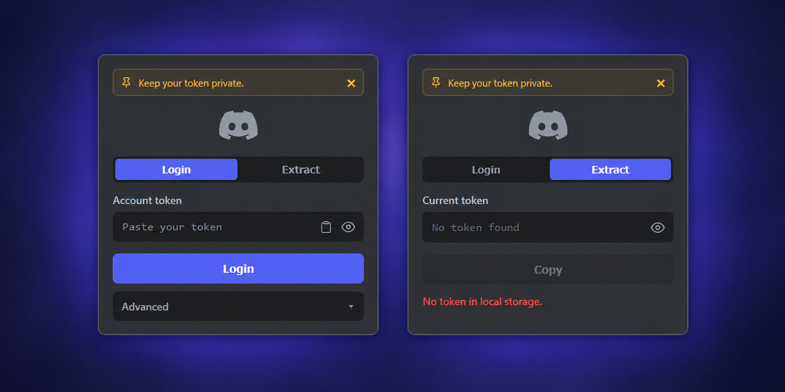

# Discord Token Extension

Chrome/Firefox extension to paste your own Discord token and sign in on the current tab, or extract the token from an open Discord tab.

> [!IMPORTANT]
> **Keep your token private. Do not share it. Anyone with your token can access your account.**

This exists only to make extracting and reusing **your own** token convenient.

## Features

| Feature | Description |
| --- | --- |
| Token login | Paste a token, inject it, redirect to DMs |
| Token extract | Read the token from an open Discord tab |
| Copy to clipboard | One-click copy with masked view |
| Auto-clear clipboard | Clears clipboard 30s after copy |
| Clear on tab close | Wipes the token when all Discord tabs close |
| Paste button | Paste token from clipboard |

## Install

1. Open `about:debugging#/runtime/this-firefox` (Firefox) or `chrome://extensions` (Chrome)
2. Load Temporary / Load unpacked → select `firefox-build` or `chrome-build`
